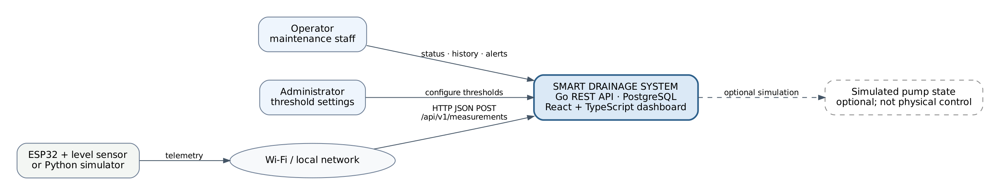
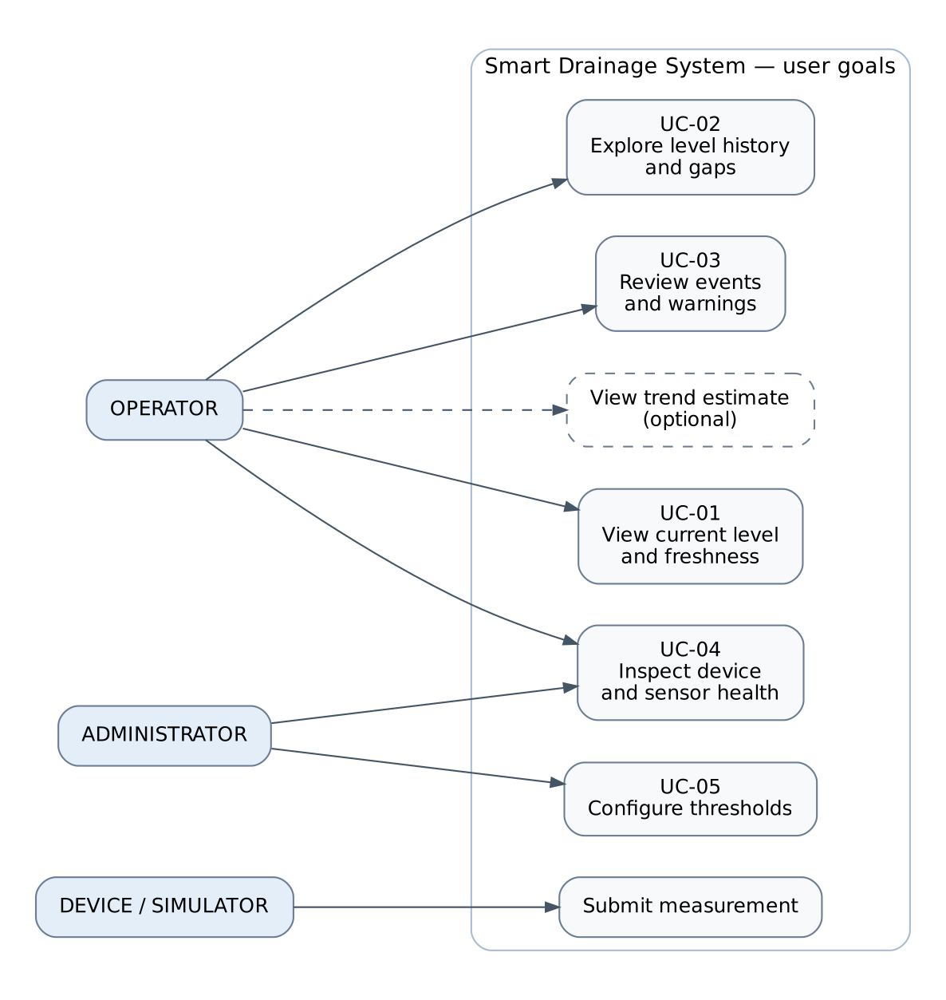
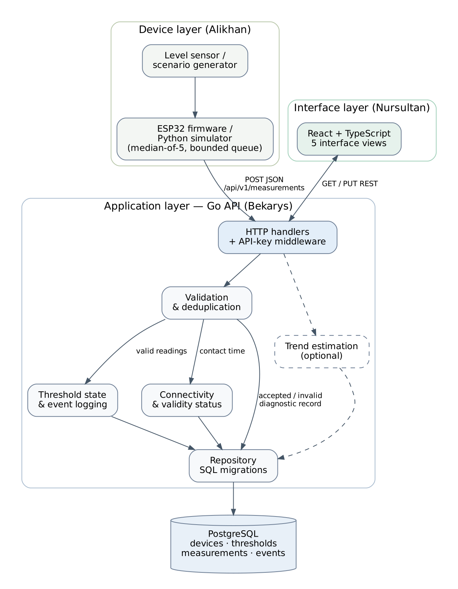

# 07. System Architecture and Diagrams

Source: Unified Diploma Project Report, Section 7 and Appendices A–B (contract revised to v1.1).

The diagram set separates **scope** (context), **user goals** (use cases) and **internal modules** (components). Each figure is rendered from an editable source in [`diagrams/`](diagrams/):

| Diagram | Editable source | Export |
| --- | --- | --- |
| System context | [`system-context.dot`](diagrams/system-context.dot) · [`.puml`](diagrams/system-context.puml) | [PNG](assets/system-context.png) · [SVG](assets/system-context.svg) |
| Use cases | [`use-case.dot`](diagrams/use-case.dot) · [`.puml`](diagrams/use-case.puml) | [PNG](assets/use-case.png) · [SVG](assets/use-case.svg) |
| Components (draft) | [`component.dot`](diagrams/component.dot) · [`.puml`](diagrams/component.puml) | [PNG](assets/component.png) · [SVG](assets/component.svg) |

The PNG/SVG files are generated from the `.dot` files (`dot -Tpng -Gdpi=150 <name>.dot -o ../assets/<name>.png`). The `.puml` files describe the same model in PlantUML notation. Diagrams are design artefacts, **not** screenshots of deployed components.

## 1. Overall data path and ownership

| Layer | Owner | Responsibility |
| --- | --- | --- |
| Device / simulator | Alikhan | Measurement, optional median-of-5 filter, range plausibility, `device_id` + `session_id` + increasing `seq`, bounded upload buffer |
| Backend | Bekarys | Validates packet and API key, records server-receipt time, stores measurements, derives state, serves REST endpoints |
| Frontend | Nursultan | Requests status, history, events, thresholds; **never** computes its own alarm state |

## 2. System context diagram



- Participants: **Operator**, **Administrator**, **ESP32 sensor node or simulator**.
- A local Wi-Fi segment carries JSON measurements; read and configuration interactions come from the dashboard.
- The pump is **optional and simulated**; the drawing does not authorise physical actuation.
- Maps to FR-01 (device), FR-15 (admin), FR-06–FR-09 (operator).

## 3. Use case diagram



- **Operator:** check level and freshness → inspect warning or history → consult event log or device page.
- **Administrator:** changes thresholds through an authenticated path; can inspect device health.
- **Device:** submits measurements; has no access to admin controls.
- Maps to FR-01, FR-05–FR-10, FR-15. The optional trend cannot be mistaken for a primary safety alarm.

## 4. Component diagram (draft)



| Component | Role |
| --- | --- |
| HTTP handlers + API-key middleware | Receive REST requests, authenticate writes |
| Validation + deduplication | Check structure and uniqueness |
| Threshold state + event logging | Record state transitions |
| Connectivity & validity status | Decide whether data are current and valid |
| Trend estimation (optional) | Uses recent valid observations only |
| Repository | Owns SQL persistence and migrations |
| PostgreSQL | `devices`, `thresholds`, `measurements`, `events` |

The separation allows unit tests of state logic **without** hardware or a database.

### Alignment of requirements, scenarios, components, data and API

| Function | Requirements | Scenario | Components | Data | Endpoint |
| --- | --- | --- | --- | --- | --- |
| Submit telemetry | FR-01, FR-02, FR-12, FR-13, FR-14 | Submit measurement (device) | Firmware/simulator → HTTP handlers → Validation & deduplication | `measurements` | `POST /api/v1/measurements` |
| Current level and freshness | FR-06, FR-08, FR-09 | UC-01 | Dashboard, Connectivity & validity status | `measurements`, `devices`, `thresholds` | `GET /api/v1/status` |
| History | FR-03, FR-07 | UC-02 | Repository | `measurements` | `GET /api/v1/measurements` |
| Events and warnings | FR-04, FR-05 | UC-03 | Threshold state & event logging | `events` | `GET /api/v1/events` |
| Device and sensor health | FR-09, NFR-09 | UC-04 | Connectivity & validity status | `devices`, `measurements.valid` | `GET /api/v1/status`, `GET /api/v1/devices` |
| Threshold configuration | FR-04, FR-15 | UC-05 | HTTP handlers (authenticated), threshold form | `thresholds` | `GET`/`PUT /api/v1/thresholds` |
| Trend estimate (optional) | FR-10 | View trend estimate | Trend estimation | valid `measurements` | `trend` in `GET /api/v1/status` |
| Pump simulation (optional) | FR-11 | Context diagram, optional | Simulation module | none | none in v1.1 |

## 5. Relational model

| Entity | Core attributes | Integrity rule |
| --- | --- | --- |
| `devices` | id, name, created_at | One persistent identifier per logical sensor node |
| `thresholds` | device_id, warning_cm, critical_cm, updated_at | One per device; critical > warning |
| `measurements` | id, device_id, session_id, seq, level_cm (nullable), valid, measured_at, received_at, recorded_at | Device FK; **unique (device_id, session_id, seq)** |
| `events` | id, device_id, type, from_state, to_state, level_cm, created_at | One event per change; link to the reading where possible |

Index: `(device_id, recorded_at DESC)` for recent-history queries.

## 6. Failure sequence (Wi-Fi drop)

1. The browser may still hold the last accepted reading.
2. After the **15 s** timeout the server reports **OFFLINE**, keeps the last valid timestamp, and the old level is not called current.
3. After reconnection retransmitted packets are deduplicated; new contact restores ONLINE independently of whether the latest sensor value is valid.
4. Both `received_at` and `measured_at` are stored, so buffered messages are not taken for new observations.

## 7. REST API contract v1.1

Base path `/api/v1`, JSON, UTC timestamps. Samples are **illustrative**, not captured from a running server. Compared with v1 the contract adds `session_id`, `last_valid_at`, `latest_sensor_ok`, `valid_reading_age_sec` and allows `water_level_cm` to be omitted on sensor failure (see decisions D-01…D-03 in [05](05-technology-comparison.md#4-contract-and-semantics-decisions)). **Backend implementation of v1.1 is pending** (DIP-18, DIP-26).

**Submit measurement**

```http
POST /api/v1/measurements
Content-Type: application/json
X-API-Key: <local-device-key>

{
  "device_id": "esp32-001",
  "session_id": "b7c1f3a2",
  "seq": 123,
  "water_level_cm": 12.4,
  "sensor_ok": true,
  "measured_at": "2026-10-22T10:00:00Z"
}
```

```http
HTTP/1.1 201 Created
{ "id": 1, "state": "NORMAL", "received_at": "2026-10-22T10:00:01Z" }
```

Sensor failure (level omitted, stored as an invalid diagnostic record, no effect on state or trend):

```json
{ "device_id": "esp32-001", "session_id": "b7c1f3a2", "seq": 124, "sensor_ok": false, "measured_at": "2026-10-22T10:00:05Z" }
```

**Current status**

```http
GET /api/v1/status?device_id=esp32-001

{
  "device_id": "esp32-001",
  "state": "NORMAL",
  "level_cm": 12.4,
  "last_valid_at": "2026-10-22T10:00:00Z",
  "valid_reading_age_sec": 1,
  "latest_sensor_ok": true,
  "online": true,
  "last_seen_at": "2026-10-22T10:00:01Z",
  "thresholds": {"warning_cm": 15, "critical_cm": 20},
  "trend": {"rate_cm_per_min": 0.0, "eta_to_critical_sec": null}
}
```

`state` is one of `NORMAL`, `WARNING`, `CRITICAL`, `NO_DATA`. `online` reflects contact only; `level_cm` is the last **valid** level (or `null`).

**History**

```http
GET /api/v1/measurements?device_id=esp32-001&limit=2

{
  "items": [
    {"id": 1, "level_cm": 12.4, "valid": true, "recorded_at": "2026-10-22T10:00:00Z"}
  ],
  "count": 1
}
```

| Endpoint | Purpose |
| --- | --- |
| `GET /api/v1/events?device_id=…` | Ordered state/online/offline events with stable ID, time, type, level when valid |
| `GET /api/v1/thresholds?device_id=…` | Read device-specific thresholds |
| `PUT /api/v1/thresholds` | Authenticated update; reject `critical ≤ warning` |
| `GET /api/v1/devices` | List monitoring devices |
| `GET /health` | Health check for local deployment |

Errors: `400` → `{"error":{"code":"validation_error","message":"device_id is required"}}`; `401` for a missing or wrong key.

## 8. Field semantics

| Field | Type / units | Rule |
| --- | --- | --- |
| `device_id` | string, 1–64 chars | Alphanumerics, hyphen, underscore |
| `session_id` | string | New value at every device boot; makes `seq` unique per session (D-02) |
| `seq` | non-negative integer | Increases within a session |
| `water_level_cm` | finite number, cm | Required when `sensor_ok=true`; optional when `false` (D-03). Nominal range 0–400, further limited by the vessel |
| `sensor_ok` | boolean | `false` samples are excluded from state and trend |
| `measured_at` | ISO-8601 UTC | Source time; latency claims need clock synchronisation |
| `received_at` | server UTC | Connectivity and audit ordering |
| `recorded_at` | UTC | Ordering timestamp for history queries |
| `valid` | boolean, server-derived | Passes plausibility/sensor checks |
| `last_valid_at` | UTC, server-derived | Time of the latest valid measurement |
| `latest_sensor_ok` | boolean | Sensor flag of the most recent packet |
| `valid_reading_age_sec` | integer | Age of the latest valid reading |

## 9. Security boundary

Key-based protection (`X-API-Key`) is adequate **only** for a trusted local demonstration (NFR-10). Public hosting would need transport encryption and stronger device identity; the browser must never hold the device-ingestion key.
