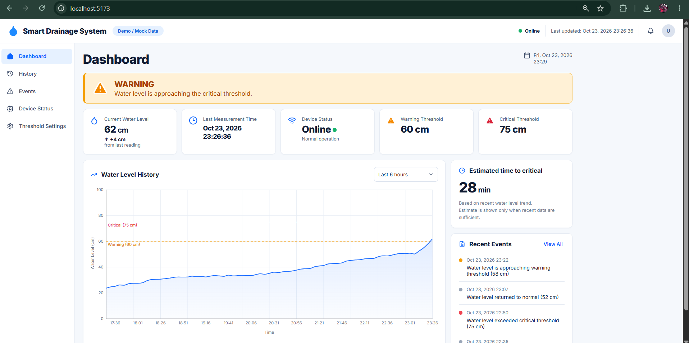
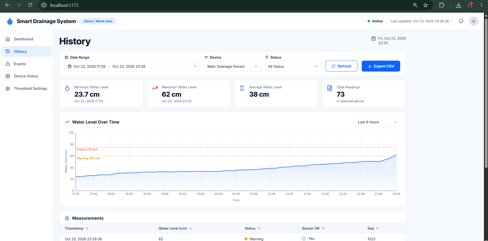
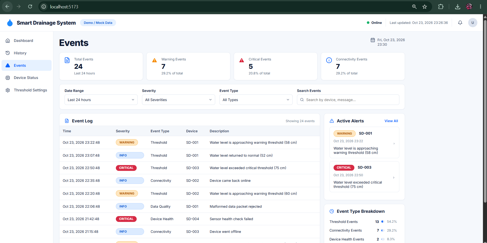
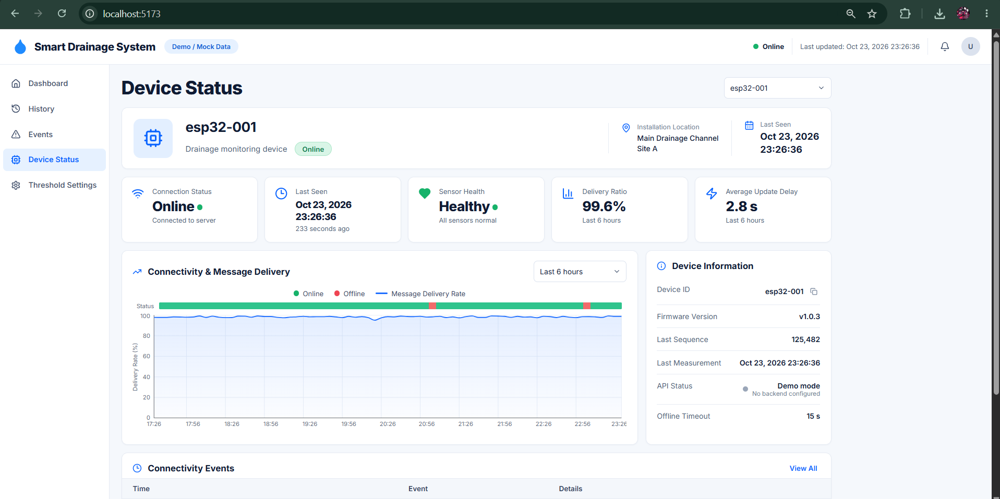
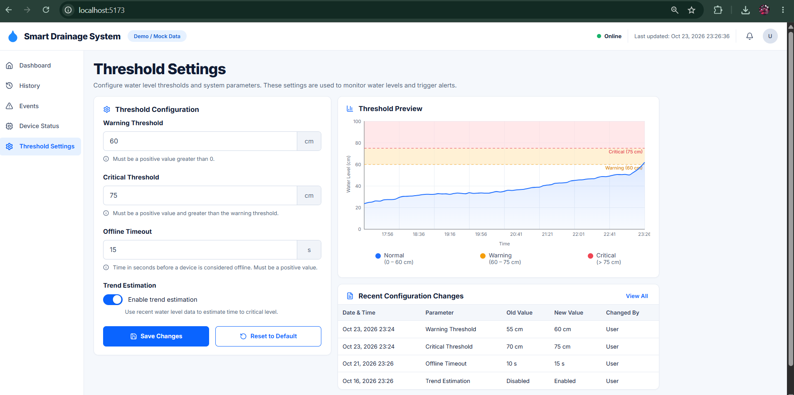
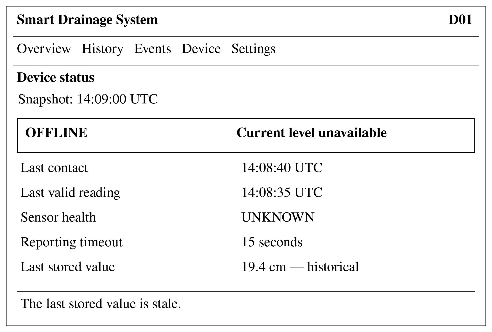
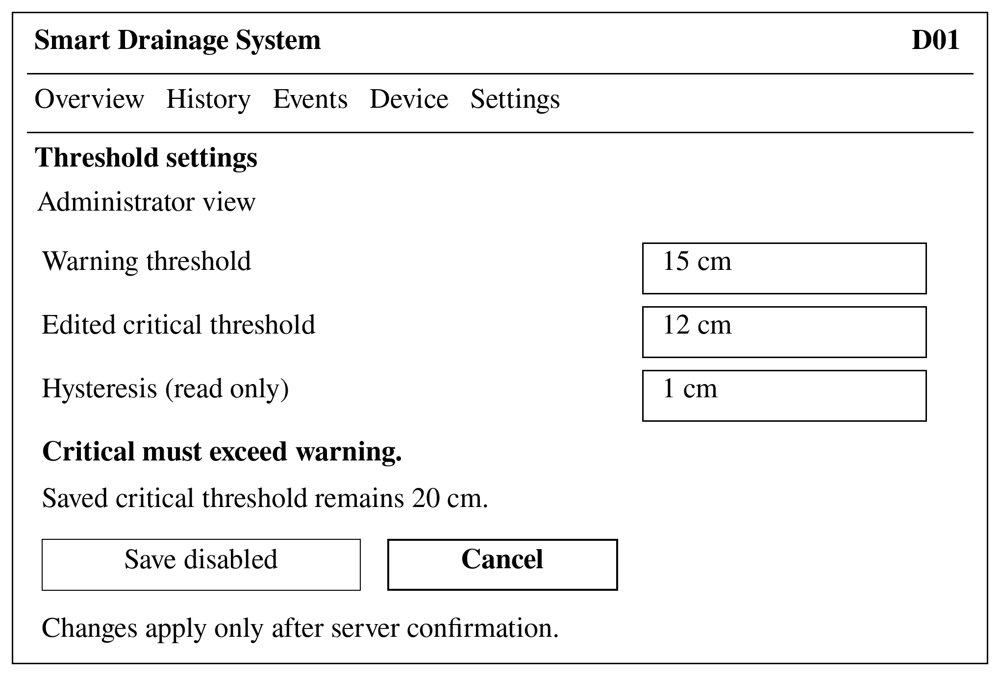

# 08. UX and Prototype

Source: Unified Diploma Project Report, Section 8.

## 1. Prototype status

| Item | State |
| --- | --- |
| Implementation | Five React + TypeScript views in a single-page application (`frontend/`) |
| How it runs | Locally on a Vite development server, `http://localhost:5173` |
| Data | **Mock data** — the header shows a "Demo / Mock Data" badge |
| Backend link | **Not yet connected** to the Go API (planned in DIP-19 → DIP-26) |
| Failure-state screens | Two design concepts (offline, invalid threshold input), not yet implemented |

**To run the prototype:** `cd frontend && npm install && npm run dev`, then open `http://localhost:5173`.

### Known deviation: illustrative thresholds

The screenshots use WARNING/CRITICAL values of **60 / 75 cm**. The API contract uses **15 / 20 cm** as demonstration defaults, and the final UI must show the thresholds returned for the selected device. The mock data are to be aligned to 15/20 cm and the screenshots re-captured under task DIP-19; until then the numbers on the images are illustrative only.

The forecast card is optional and must be hidden whenever prediction conditions are not met (FR-10).

## 2. Scenarios and screens

### UC-01 — Dashboard / TankGauge

The operator starts with the latest valid level, a prominent state label, measurement time and connectivity status. TankGauge and the level chart add context. A WARNING/CRITICAL banner marks an actionable level condition; offline and invalid-sensor states are treated differently from a safe level.

### UC-02 — History and trend context

The operator changes device and period and compares recorded values with threshold lines. A discontinuity marks missing records. Period selection survives refresh; with no data the graph shows an **empty state**, not a flat line at zero.

### UC-03 — Events and warnings

The operator opens the events table to tell a **level-state transition** from a **device-connectivity event**. Each row shows time, type, device and severity. Refreshing preserves event identity and never fabricates water levels for communication failures.

### UC-04 — Device status

The operator checks **last contact separately from last valid measurement**. Sensor failure with a connected device is explained differently from an unreachable backend. Restored network contact alone does not establish a good level reading.

### UC-05 — Threshold settings

An authorised administrator edits WARNING and CRITICAL. The form rejects non-numeric or reversed limits and keeps the last accepted values until the server confirms. The browser never stores the ESP32 device-ingestion API key on public or untrusted hosting.

## 3. Failure-state designs

Two cases missing from optimistic dashboard screenshots; they are fixtures for the final components.

**Offline device** — a labelled historical value, not a current safe reading:

**Invalid threshold input** — warning 15 cm, edited critical 12 cm (rejected), saved critical 20 cm:

## 4. Scenario → requirement mapping

| Scenario | Requirements |
| --- | --- |
| UC-01 | FR-06, FR-08, FR-10, NFR-07, NFR-09 |
| UC-02 | FR-07, NFR-08 |
| UC-03 | FR-05, FR-08 |
| UC-04 | FR-09, NFR-09 (needs `last_valid_at`, see [07](07-architecture-and-diagrams.md#7-rest-api-contract-v11)) |
| UC-05 | FR-15, NFR-10 |

## 5. Planned checks

- VT-06, VT-07: state/value agreement, gap and empty-state rendering.
- VT-17: keyboard traversal, contrast (WCAG 2.2 AA), viewports 360 px and 1366 px.
- Task-based usability session with 3–5 intended users or representatives (H-02, DIP-27).
